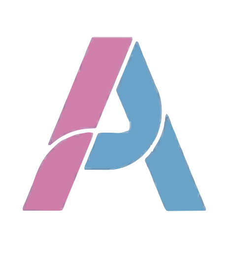

<div align="center">
  

  # Athene

  **Turn any AI coding agent into a disciplined engineering team.**

  [](LICENSE)
  [](https://discord.gg/CT6wsqa2Ct)
  [](https://www.linkedin.com/in/saksham-sharma-292ba51bb)
</div>

Athene is a set of connected AI-agent skills that make a coding agent work like a disciplined
engineering team by default — not just a code generator.

Left alone, an AI agent writes code that runs but skips everything else a real engineering org
does: no issue/PR discipline, no review gate, no CI/CD design, no evidence-backed architecture
decisions, no governance, no sense of when *not* to ship a feature. Athene fills that gap. It
discovers the right thing to build, builds it with real repo hygiene and an engineering quality
bar, launches the smallest version that teaches you something, and picks work back up later
without re-asking questions already answered — or retrofits the same discipline onto a repo that
already exists.

Built for engineering teams shipping real, production code — not a tutorial layer. The governance
it generates (CODEOWNERS, branch protection, commitlint, SECURITY.md) and the engineering quality
bar it enforces (threat modeling, latency budgets, fault tolerance, checklist-driven review) assume
a repo where getting it wrong has real consequences.

## Why it's different

**Research runs before code, every time.** Before writing a feature or function, Athene checks
what's actually in your repo (stack, conventions already set) and pulls in real engineering
sources matched to the topic — a payments feature gets checked against real payments-engineering
writing, a search feature against search-engineering sources. No matching source for a topic? It
searches live rather than guessing. Nothing gets built off the model's memory alone.

A few other things that come for free:

- **It remembers where you left off.** A small state file tracks what's decided, what phase you're
  in, and what's still open — so picking the project back up never means re-explaining yourself.
- **Governance is generated, not just suggested.** CONTRIBUTING.md, PR/issue templates, CODEOWNERS,
  SECURITY.md, commitlint, and a release policy are real files written into your repo, scaled to
  how risky and how public the project actually is — not advice left in a chat window.
- **Shortcuts have to admit they're shortcuts.** Every deliberate corner cut gets a marker naming
  its limit and when to fix it, swept into a debt ledger so it can't quietly rot.
- **Every PR gets reviewed before a human sees it.** A self-review pass checks the diff first,
  including every comment left behind — a comment survives only if it's justified by something
  genuinely outside your control; otherwise it gets replaced with real enforcement (a type, a test,
  a lint rule) instead of just prose.
- **Launch resists feature creep on purpose.** Every scope addition gets challenged: does this help
  you learn the thing you're trying to learn, or does it just make the product feel more finished?

## How to use it

1. **Starting something new?** Just describe what you want to build. Athene figures out whether
   this needs product discovery first or can go straight to building, and starts there.
2. **Working in an existing repo Athene hasn't touched?** Ask it to build or ship something, and
   it scans the repo first and sets up the right governance before writing code.
3. **Coming back to a project later?** Just start talking — Athene reads its own state file,
   tells you what was already decided and what's still open, and picks up from there instead of
   starting over.
4. **Want a repo health check with no changes made?** Ask for a code review / audit of the repo —
   you'll get a ranked list of bugs, security risks, scale problems, missing tests, and bloat.

No slash commands or manual hand-offs needed in the middle of a flow — each skill knows when to
pass control to the next one on its own.

## Install

**Claude Code**, as two separate prompts:

```
/plugin marketplace add saksham-shr/athene
```
```
/plugin install athene@athene
```

**Codex**, as two separate prompts:

```
codex plugin marketplace add saksham-shr/athene
```
```
codex plugin add athene@athene
```

The plugin install above pulls skill content from `.agents/skills/` — Codex reads each skill's
selection description straight from its own `SKILL.md` there, same as the manual-copy path below.
[`agents/openai.yaml`](agents/openai.yaml) at the repo root is a separate, repo-level reference
(display names, invocation notes) — it isn't part of the installed plugin content.

**Cursor, or any other agent that reads a `SKILL.md`-style file:** copy the skill(s) you want
from [`.agents/skills/`](.agents/skills/) or [`.claude/skills/`](.claude/skills/) — not
[`skills/`](skills/), which holds this repo's editable source and may contain unexpanded include
stubs — into your project's `.agents/skills/` or `.claude/skills/` directory, or point your agent
at that folder directly.

## The seven skills

```
Product Discovery ──► Athene (build) ──► Launch ──► (pivot) back to Product Discovery
        ▲                    ▲                             │ (otherwise: cycle ends)
        │                    │
   Resume ──reads state file──┘
        │
   Audit ──(no state file found)
```

| Skill | What it does |
|---|---|
| **Product Discovery** | Turns a vague idea into an approved product brief. Maps the real customer opportunities, scores which one is worth solving, compares 2-3 genuinely different solutions for it, and scopes a now/later/never release — instead of jumping straight to a feature list. |
| **Athene (build)** | The core skill: repo lifecycle, ownership, CI/CD, stack decisions, architecture, governance, and the review gate. Every stack choice (language, hosting, database, CI/CD tool) gets a real options table and a self-hosted-vs-managed question — never a raw "what's your budget". Every nontrivial architecture decision gets backed by real evidence and a quality-bar check (security, latency, failure handling) before it's final. Writes the governance files your repo needs and runs a self-review pass before any PR waits on you. |
| **Launch** | Cuts scope to the smallest release that can actually teach you something, picks the right channels to announce through, and runs the post-launch review: keep going, change direction, fix the core workflow, or stop. |
| **Audit** | Onboarding for a repo Athene has never touched. Scans what's already there, figures out how risky/public the project is, and writes the matching governance set without overwriting anything that already works. |
| **Resume** | Session-start continuity. Reads the state file and tells you exactly where things stand — current phase, decisions made, open questions — then picks up from there. |
| **Code Health** | A one-time quality report on the whole repo: bugs, security risks, scale limits, missing tests, slow paths, and bloat, ranked by how much it matters. It's a report, not a fix — doesn't touch your source on purpose, though a configured mutation-testing tool it runs may still write its own cache/report files. |
| **PR Review** | Pick an open PR you authored or were asked to review, and get the same kind of quality check Code Health runs — scoped to just that PR's changes — left as a real comment on the PR, disclosed as an automated review. One PR at a time, only when you ask for it. |

## FAQ

**Do I have to use all of it?**
No. Each skill names when to skip itself — a precise, low-risk task never needs Discovery, and
a one-off script doesn't need the full build lifecycle.

**Does it phone home or need an account?**
Athene itself needs no account or server of its own — it's instructions your agent reads
locally. Your agent still does whatever it normally does: sends prompts to its model, runs
linters or live searches a skill tells it to when that's useful. Athene doesn't add any network
calls beyond what your agent already makes.

**What if my agent isn't listed above?**
If it can read a `SKILL.md`-style instruction file, point it at the one you want from
[`.agents/skills/`](.agents/skills/) directly.

## Community

Questions, ideas, or just want to see what's being built next — [join the Discord](https://discord.gg/CT6wsqa2Ct).
Connect on [LinkedIn](https://www.linkedin.com/in/saksham-sharma-292ba51bb).

## License

[MIT](LICENSE).
